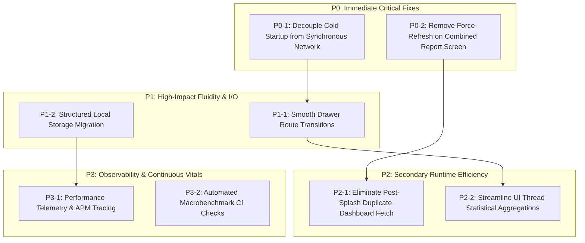

# Prioritized Mobile Performance Optimization Plan: Milk Passbook

**Target Application:** Milk Passbook (Flutter Android / iOS)  
**Engineering Goal:** Eliminate startup delays, eradicate frame jank during navigation, reduce cellular data consumption, and ensure high responsiveness on low-to-mid range Android hardware.  
**Implementation Rule:** Analysis first. Maintain exact API contracts, offline availability, multi-account session management, and UI visual fidelity.

---

## 1. Prioritization Matrix & Overview



---

## 2. P0: Severe Responsiveness & Blocking Issues (Immediate Execution)

### [P0-1] Decouple Cold Startup from Network Synchronization (Offline-First SWR)
- **Target File:** `lib/screens/splash_screen.dart`
- **Current Flow:**
  `SplashScreen` awaits `Firebase.initializeApp()`, then awaits `ApiService.login()`, then awaits `apiService.syncMemberData()`. Cold startup is blocked for 3.5s to 8+ seconds until all 6 HTTP requests complete.
- **Optimized Architecture:**
  1. Initialize local cache (`apiService.init()`) and read `savedUser`.
  2. If `savedUser` is present:
     - Navigate immediately to `MainScreen(userInfo: savedUser)`.
     - Time from app icon tap to interactive dashboard drops to **< 1,000ms**.
  3. Dispatch session verification (`ApiService.login`) and delta synchronization (`apiService.syncMemberData`) in an **asynchronous non-blocking background task**.
  4. On background sync completion:
     - Update local cache.
     - Notify active screens via reactive stream, event bus, or state provider.
     - If the token is rejected (HTTP 401), prompt a non-intrusive re-authentication dialog rather than crashing or freezing.
- **Success Criteria:**
  - **Cold Start Time (TTID):** Reduced from **3,800ms–8,000ms** to **< 1,100ms** (75%–85% reduction).
  - **Offline Startup:** App opens into interactive mode in **< 900ms** with zero network errors displayed during launch.
- **Verification Protocol:**
  - Launch app under throttled 3G profile using Android Studio Network Profiler.
  - Verify dashboard displays instantly with cached records and a subtle syncing indicator in the app bar.

---

### [P0-2] Remove Unconditional `forceRefresh: true` from Combined Report Screen
- **Target File:** `lib/screens/combined_report_screen.dart` (Lines 313–322)
- **Current Flow:**
  Every call to `_generateReport(period)` invokes:
  ```dart
  await ApiService().fetchPassbook(..., forceRefresh: true);
  await ApiService().fetchDeductions(..., forceRefresh: true);
  ```
  This causes network calls and a full-screen loading spinner every time a user changes the bill period.
- **Optimized Architecture:**
  1. Change `forceRefresh: false` in `_generateReport`.
  2. Load passbook entries and deductions directly from the local cache.
  3. Filter and group entries in-memory instantly.
  4. Add an explicit "Pull to Refresh" or refresh action button in the AppBar for users who deliberately wish to re-query the backend.
- **Success Criteria:**
  - **Bill Period Selection Latency:** Reduced from **1,800ms–3,500ms** to **< 50ms** (instantaneous UI response).
  - **Network Requests:** Eliminates 2 redundant full-table GET requests per dropdown change.
- **Verification Protocol:**
  - Open Combined Report screen.
  - Switch between 5 different historical bill periods in succession.
  - Confirm instant table rendering without spinner or frame stutter.

---

## 3. P1: High-Impact Fluidity & Storage Optimizations

### [P1-1] Smooth Drawer Closing and Lazy Route Navigation
- **Target File:** `lib/screens/main_screen.dart` (Lines 20–27 & drawer items)
- **Current Flow:**
  Widget constructors are invoked eagerly inside the tap callback while the drawer is animating closed, causing dropped frames during the drawer transition.
- **Optimized Architecture:**
  1. Pass a lazy widget builder callback `WidgetBuilder` to `_openScreenAfterDrawer`.
  2. Await the completion of the drawer pop animation before pushing the new route:
     ```dart
     void _openScreenAfterDrawer(BuildContext context, WidgetBuilder builder) {
       Navigator.of(context).pop();
       // Allow drawer slide-out animation to complete at 60fps
       Future.delayed(const Duration(milliseconds: 220), () {
         if (context.mounted) {
           Navigator.of(context).push(MaterialPageRoute(builder: builder));
         }
       });
     }
     ```
  3. Wrap destination screens in `RepaintBoundary` to prevent drawer repaints from invalidating screen layouts.
- **Success Criteria:**
  - **Transition Frame Rate:** 0 dropped frames during drawer slide-out (consistent 16.6ms frame budget).
  - **Perceived Responsiveness:** Instant drawer dismissal feedback upon tap.
- **Verification Protocol:**
  - Profile using Flutter DevTools Performance view in Profile mode on an Android device.
  - Verify that the UI thread frame time remains strictly under 16ms during drawer close.

---

### [P1-2] Transition from `SharedPreferences` to Structured Local Storage (SQLite / Key-Value)
- **Target Files:** `lib/service/api_service.dart`, `lib/service/sync_metadata.dart`
- **Current Flow:**
  Tabular data arrays (`passbook_*`, `deductions_*`, `ledger_all_*`, `bill_transactions_*`) are stored as serialized JSON strings in Android `SharedPreferences`. Android serializes the entire XML file on each write.
- **Optimized Architecture:**
  1. Maintain `SharedPreferences` strictly for lightweight configuration (theme, language code, tokens, flags).
  2. Migrate tabular collections to an embedded structured store:
     - **Option A (Lightweight Binary Store):** Hive / Isar / SQLite (`sqflite`).
     - Define indexed keys per society and member: `(socCode, memCode, recordDate)`.
  3. Implement an automatic first-launch data migrator that reads existing `SharedPreferences` keys, populates the new database, and clears the bulky keys from `SharedPreferences`.
- **Success Criteria:**
  - **Disk Write Latency:** Drops from **80ms–250ms** (full XML serialization) to **< 5ms** per sync operation.
  - **Memory Footprint:** Reduces heap churn by eliminating multi-megabyte string concatenations.
- **Verification Protocol:**
  - Inspect `/data/data/com.erpmilk.passbook/shared_prefs/FlutterSharedPreferences.xml` size; ensure it remains under **10 KB**.

---

## 4. P2: Secondary Runtime & Computation Optimizations

### [P2-1] Eliminate Redundant Post-Splash Dashboard Re-fetch
- **Target File:** `lib/screens/dashboard_screen.dart` (Lines 148–167)
- **Current Flow:**
  Mounting `DashboardScreen` immediately calls `_fetchData()`, requesting `fetchPassbook()` even though data was just synced during app launch.
- **Optimized Architecture:**
  1. `DashboardScreen` checks `ApiService().hasInMemoryCache(socCode, memCode)`.
  2. If cached data is present in memory, initialize state synchronously without triggering a redundant fetch or loading state.
  3. Only initiate background refresh if the cache is stale (> 30 minutes old) or user explicitly pulls to refresh.
- **Success Criteria:**
  - **Initial Screen Paint:** Eliminates the intermediate loading skeleton/spinner on initial dashboard mount.
  - **CPU Cycles:** Eliminates duplicate JSON model deserialization.
- **Verification Protocol:**
  - Cold launch app and inspect debug logs; confirm `fetchPassbook` is invoked only once.

---

### [P2-2] Single-Pass & Background Statistical Aggregations
- **Target File:** `lib/screens/dashboard_screen.dart` (Lines 95–130)
- **Current Flow:**
  `_recomputeDerivedStats` runs multiple sequential iterations over `_filteredEntries` (`fold` for liters, `fold` for amount, `fold` for fat, separate calls for morning, evening, cow, buffalo).
- **Optimized Architecture:**
  1. Combine statistics calculations into a **single $O(N)$ pass**:
     ```dart
     double totalLiters = 0.0;
     double totalAmount = 0.0;
     double weightedFat = 0.0;
     // Single loop computes liters, amount, weighted fat, and session breakdown simultaneously
     for (final e in _filteredEntries) {
       totalLiters += e.liters;
       totalAmount += e.amount;
       weightedFat += (e.fat * e.liters);
       // Session and animal accumulation...
     }
     ```
  2. For large historical lists (> 1,000 entries), dispatch the aggregation to a background isolate using Flutter's `compute()` to prevent any frame drops.
- **Success Criteria:**
  - **Aggregation Execution Time:** Reduced from **25ms–45ms** to **< 4ms** on mid-range Android processors.
- **Verification Protocol:**
  - Filter 1,000+ entries on dashboard; confirm frame render stays under 16ms in Flutter DevTools.

---

## 5. P3: Long-Term Monitoring & Architecture Improvements

### [P3-1] Continuous Application Performance Monitoring (APM)
- Integrate standard performance tracking SDK (e.g. Firebase Performance Monitoring or Sentry):
  - Custom traces on `app_cold_startup`, `dashboard_render_time`, `report_generation_time`.
  - HTTP network metrics tracking failure rates and 95th percentile latency across endpoints (`/api/passbook/list`, `/api/Billtrans/allbilltrans`).

### [P3-2] Automated Macrobenchmark CI Verification
- Establish automated Flutter Driver / Integration Test benchmarks run against release APKs:
  - Startup benchmark: `flutter test integration_test/startup_benchmark_test.dart --profile`.
  - Enforce automated alerts if TTID exceeds 1,500ms or slow frames exceed 5% in CI test runs.

---

## 6. Execution Roadmap & Safety Milestones

| Milestone | Scope | Target Completion | Regression Risk | Verification Gate |
| :--- | :--- | :--- | :--- | :--- |
| **Milestone 1** | Implement [P0-1] Offline-First Startup & [P0-2] Combined Report Cache Fix | Sprint 1 | Low | Manual cold start on 3G + automated unit tests |
| **Milestone 2** | Implement [P1-1] Smooth Drawer Transitions & [P2-1] Redundant Fetch Removal | Sprint 1 | Low | DevTools profile trace verifying 60fps |
| **Milestone 3** | Implement [P2-2] Single-Pass Aggregations | Sprint 2 | Very Low | Math verification tests on totals & averages |
| **Milestone 4** | Implement [P1-2] Structured Local Storage Migration | Sprint 3 | Medium | Multi-account migration test + DB persistence test |
| **Milestone 5** | Implement [P3-1] APM Traces & Benchmarks | Sprint 4 | Low | Firebase Console live metric validation |
