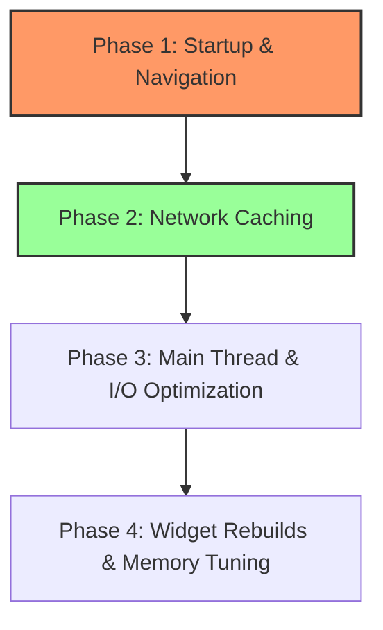

# Flutter Performance Audit & Optimization Roadmap

This document summarizes the identified performance bottlenecks in the Milk Passbook application, detailing their root causes, user impacts, recommended fixes, and an implementation roadmap.

---

## 1. Executive Summary
An audit of the codebase reveals that the 1–5 second delays and responsiveness issues are primarily caused by:
1. **Artificial Delays at Startup**: Multiple hardcoded `Future.delayed` calls block the startup flow.
2. **"Network-First" Caching Policy**: Crucial API calls (Ledger, Account Names, Milk Sales) always wait for network requests before showing cached data.
3. **Synchronous JSON Parsing on the UI Isolate**: Heavy JSON encoding/decoding is performed synchronously on the main thread for caching, blocking the event loop for larger datasets.
4. **Redundant UI Computations**: Heavy list fold/reduce computations run directly inside the `build()` methods during layout.

---

## 2. Identified Performance Bottlenecks

### A. App Startup Time
| Metric | Details |
| :--- | :--- |
| **Location** | [splash_screen.dart](file:///d:/Office/Passbook/Milk/passbook/lib/screens/splash_screen.dart#L68-L157) |
| **Root Cause** | Multiple artificial delays (`Future.delayed` ranging from `500ms` to `800ms`) are chained together during Firebase initialization, token loading, auto-login, and navigation routing. |
| **User Impact** | The user is forced to wait on the splash screen for an extra 1.5 to 2.5 seconds regardless of network speed or device capability. |
| **Performance Impact** | Unnecessary event loop blocking and increased startup latency. |
| **Recommended Fix** | Remove artificial delays entirely, or replace them with a minimum display duration logic (e.g. using a Stopwatch to only delay if initializations finish in under `800ms`). |
| **Expected Improvement** | App startup time reduced by **1.5s - 2.0s**. |
| **Priority** | **High** |

---

### B. Caching Strategy & Network Latency
| Metric | Details |
| :--- | :--- |
| **Location** | [api_service.dart](file:///d:/Office/Passbook/Milk/passbook/lib/service/api_service.dart#L380-L495) (`fetchAccountNames`, `fetchLedgerTransactions`, `fetchMilkSales`) |
| **Root Cause** | Unlike `fetchPassbook` and `fetchDeductions`, these methods make network requests (`http.get`) first and only fall back to the cache if the network fails. There is no cache-first policy or in-memory cache. |
| **User Impact** | Navigating to the Ledger or Milk Sales page causes a loading spinner to display for 1–5 seconds while waiting on the network, even if offline/cached data is available. |
| **Performance Impact** | High network dependency; poor user experience on slow connections. |
| **Recommended Fix** | Implement a **Cache-First** strategy when `forceRefresh` is false. Return cached data immediately, then optionally fetch fresh data in the background to update the cache and UI. |
| **Expected Improvement** | Navigation response time drops from **1-5s** to **instantly (<50ms)** when cached data exists. |
| **Priority** | **High** |

---

### C. Database & Caching I/O (Main Thread Blocking)
| Metric | Details |
| :--- | :--- |
| **Location** | [api_service.dart](file:///d:/Office/Passbook/Milk/passbook/lib/service/api_service.dart#L244-L259) (`_saveCache`, `_loadCache`) |
| **Root Cause** | Caching relies on `SharedPreferences` where large datasets (e.g. hundreds of passbook/ledger records) are serialized/deserialized synchronously using `jsonEncode` and `jsonDecode` on the main UI thread. |
| **User Impact** | The application freezes briefly (micro-stutters/jank) when transitioning between screens or loading tables. |
| **Performance Impact** | Blocks the Dart isolate event loop, leading to dropped frames (jank). |
| **Recommended Fix** | Use `compute()` or background Isolates to perform JSON serialization/deserialization for large payloads, or transition to a lightweight binary key-value database (e.g., Hive or Isar). |
| **Expected Improvement** | Eliminates frame drops and UI freezes during data loading. |
| **Priority** | **Medium** |

---

### D. Widget Rebuilds & State Management
| Metric | Details |
| :--- | :--- |
| **Location** | [dashboard_screen.dart](file:///d:/Office/Passbook/Milk/passbook/lib/screens/dashboard_screen.dart#L150-L162) |
| **Root Cause** | Computations such as `_totalLiters` and `_totalEarnings` (which perform a `.fold` loop over the entire dataset) are implemented as getters and evaluated directly inside the `build()` method. |
| **User Impact** | Interactive changes (like scrolling or toggling metrics) feel slightly laggy. |
| **Performance Impact** | Unnecessary $O(N)$ calculations run repeatedly on every widget rebuild or frame update. |
| **Recommended Fix** | Calculate totals once when the dataset is loaded or changed, and store them as state variables (or using a Provider/State-Notifier) rather than evaluating folds inside `build()`. |
| **Expected Improvement** | Smoother UI rendering and lower CPU usage during widget rebuilds. |
| **Priority** | **Medium** |

---

### E. Image Preloading & SVG Parsing
| Metric | Details |
| :--- | :--- |
| **Location** | [splash_screen.dart](file:///d:/Office/Passbook/Milk/passbook/lib/screens/splash_screen.dart#L259) & [company_logo.dart](file:///d:/Office/Passbook/Milk/passbook/lib/widget/company_logo.dart) |
| **Root Cause** | Large assets (like `logo_big.jpg` or `logo_small.svg`) are loaded directly during rendering without pre-caching. |
| **User Impact** | Brief visual flickering or blank space when the logo first mounts. |
| **Performance Impact** | Image decoding and asset parsing on first render can cause minor frame jank. |
| **Recommended Fix** | Use `precacheImage` during splash screen initialization to warm up the image cache. |
| **Expected Improvement** | Seamless logo rendering without frame drops. |
| **Priority** | **Low** |

---

## 3. Implementation Roadmap

### Phase 1: Startup & Navigation (High Priority)
1. **Optimize SplashScreen**: Remove hardcoded delays in `splash_screen.dart`. Wrap service initializations in a parallel `Future.wait` flow.
2. **Precache Assets**: Warm up image caches for `logo_big.jpg` and company logos in parallel.

### Phase 2: Network Caching (High Priority)
1. **Cache-First API implementation**: Refactor `fetchAccountNames`, `fetchLedgerTransactions`, and `fetchMilkSales` inside `ApiService` to look up cache first.
2. **Background Refresh**: Implement a silent background fetch that updates the cache and notifies the UI when fresh data is retrieved.

### Phase 3: Main Thread & I/O Optimization (Medium Priority)
1. **Background JSON Parsing**: Move JSON encoding/decoding for large transaction arrays off the main isolate using `compute()`.
2. **Database Cache**: If necessary, move from `SharedPreferences` to a fast database storage engine (e.g. Hive).

### Phase 4: Widget Rebuilds & Memory Tuning (Medium/Low Priority)
1. **Dashboard Computations**: Cache fold calculations (`_totalLiters`, `_totalEarnings`) inside state variables rather than executing them inside the `build()` loop.
2. **Const Constructors**: Maximize the use of `const` constructors for static widgets to prune rebuild trees.
